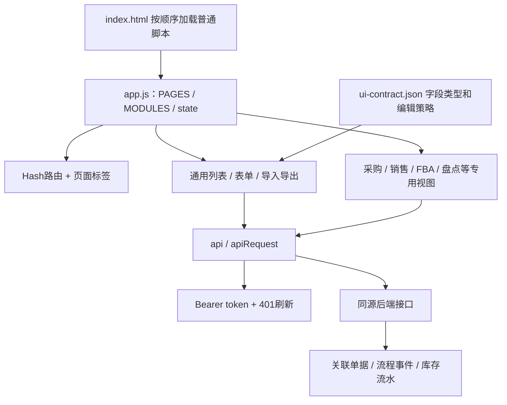
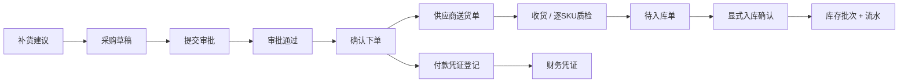

# ERP 逆向分析与改造依据

分析日期：2026-10-13（北京时间）
目标：https://47.107.76.124/lingxing-erp/
工具：REA 6.4.0 静态 JavaScript 分析 + 本地源码及 OpenAPI 契约提取。

## 已得到的结果

公开前端源码是可读的原生 JavaScript，无须先反编译压缩包。页面通过 PAGES 配置、通用列表与编辑器、专用业务渲染器构建。没有发现前端框架的构建入口；这不证明服务器端采用何种语言或框架。

| 项目 | 数量 | 含义 |
| --- | --- | --- |
| 业务模块 | 13 | 产品、销售、FBA、采购、仓库、物流、广告、客服、财务、统计、BI、工具、设置 |
| 菜单入口 | 123 | 来自 MODULES；不含首页 |
| 仍保留 aliasOf 的菜单 | 57 | 复用已有页面视图/资源，不能视为57套独立功能 |
| OpenAPI 路径 / 操作 | 179 / 253 | 文档声明，尚未逐接口运行验证 |
| 接口方法 | GET 103、POST 104、PUT 25、DELETE 21 | 包含只读查询使用 POST 的兼容接口 |
| OpenAPI schemas | 127 | 请求、响应及资源类型，不能直接等同数据库表 |
| UI 写入 schemas | 21 | 普通资料维护字段及编辑策略 |
| JavaScript 文件 | 27 | REA 全部解析成功 |

入口数量和资源数量的差异直接影响改造工作量。比如采购价管理、委外订单和1688下单仍复用采购单；ChatGPT文案复用接口文档页面。它们的菜单标题不能证明实际接入了对应服务。[完整菜单映射](PAGE-MAP.md)

## REA 实际执行结果

已运行固定版本的 analyze-javascript-application，目标是本地前端快照，未执行目标脚本。扫描30个相关文件、读取1,141,092字节文本、访问59,930个AST节点、输出50项发现、解析失败0项。REA 的 modules=0 是其模块恢复统计；该站使用全局普通脚本，因此不表示ERP没有业务模块。

原始工具证据：[rea-application.json](rea-application.json)，日志：[rea-stderr.log](rea-stderr.log)，精简统计：[rea-summary.json](rea-summary.json)。证据约51 MB。

REA 声明静态关系不证明运行时执行。部分采购结算、收货、销售、退货、盘点等文件的深层语义图触及父级输出预算；这些文件的静态事实仍保留。业务说明另行依据可读源码和接口描述核对。尚未声称完整恢复所有运行关系。

## 前端架构

- app.js:1 根据 pathname 确定部署前缀 /lingxing-erp，页面移到根目录后前缀为空。
- app.js:22 起 PAGES 定义页面与资源；app.js:108–157 构建复用页面并覆盖部分专用视图；app.js:158 起 MODULES 定义菜单。
- app.js:543 的 loadContract 加载字段规则，再修正页面字段、校验与维护策略。启动必须先成功加载契约。
- app.js:794 起 renderPage 按 type 调用专用渲染器，其他进入通用列表。专用脚本通过全局函数和 document 事件与主脚本协作，加载顺序必须保留。
- business-workspace.js 提供单据展示和Hash路由；document-controller.js 提供单据标签、详情与关联读取，数据所有权仍在后端。
- localStorage 保存列顺序、隐藏和固定；sessionStorage 保存访问令牌、刷新令牌和账号标识。
- 列表使用 limit/offset 分页、q/field/status/日期条件；请求可取消，renderEpoch 防止旧页面请求覆盖新页面。

## 认证与权限

app.js:228–275：
1. 用户账号密码以 appId/appSecret 提交到 POST /api/auth-server/oauth/access-token。
2. apiRequest 为业务请求加入 Authorization: Bearer。
3. 401触发 /api/auth-server/oauth/refresh；refreshPromise 合并并发刷新；失败清理会话并显示登录框。
4. /api/session 分支仍存在于代码，但 createSession 开头已经要求账号密码，正常调用无法进入匿名分支。不可据此认为生产支持匿名登录。

access-control.js:2–26：
- /api/v1/me 返回身份、permissions、scope；权限格式为 resource:read/write/delete 或 resource:action:动作，星号表示超级权限。
- 登录账号与普通员工资料分开，修改 users 资料不等于新增登录权限。
- 页面按权限禁用按钮；契约声明服务端强制校验。服务端执行效果未通过登录实测。
- 数据范围包含店铺和仓库；前端说明空范围拒绝访问，null 表示不限范围；同时涉及店铺与仓库要同时获授权，调拨要求两端仓库。
- 没有 costs:read 时隐藏部分成本字段；仅前端隐藏不能代替后端脱敏，复刻时须验证响应字段。
- 契约声明：改密、停用、换角色撤销旧会话；角色和数据范围变更即时生效。具体实现尚未取得。

## 核心业务流

下列是源码可见动作及契约声明的效果，不等于已验证的服务器实现。

### 采购、收货与付款

app.js:675–685 与 receiving-workflow.js：
- 补货 create-purchase、采购 submit/place-order/void、审批 decide、送货 receive/inspect 是专用动作。
- 契约明确普通收货生成待入库单，不自动过账库存；供应商预检有专门限制。
- 累计超收、不存在来源采购单、多SKU部分收货缺少逐SKU数量时须拒绝。

purchase-settlement.js:1–20：
- record-payment 登记本地付款凭证，不执行银行转账。
- 契约要求付款参考号精确幂等、币种一致、不得超付。
- finish-arrival 结束剩余到货，保留已收货、库存、付款历史，并阻止后续收货。
- 冲销生成补偿凭证，保留原付款记录。

purchase-amendments.js：
- 变更流程：draft → submitted → approved → applied；submitted 可 rejected。
- 保留 original/proposed 与事件，应用变更需要核对快照是否因付款或收货而失效。
- 原始单据和付款凭证不能直接删除来模拟冲销。

### 销售与退货

sales-workflow.js:4–31：
- unpaid 登记付款后进入可发货状态；仅 paid/partially-shipped 可新增发货批次。
- 每批提交 reference、item_list、carrier、tracking_no，按SKU扣可用库存并关联出库单。
- 冻结阻止后续发货；解除冻结恢复原阶段。只有未收款状态提供取消按钮。
- legacy/shipped/cancelled 在该界面锁定后续修改。
- 契约声明库存不足或活动盘点冲突整笔回滚；相同参考号及相同内容重试不重复扣库存。
- 关联销售出库禁止单独冲销、编辑、删除。

sales-returns.js：
- draft → authorized → received → refunded；未收货可取消并释放额度。
- 退货只能基于本地实际已发货订单，并限制逐SKU可退数量。
- 授权占用退货数量和退款额度；收货按良品/次品质检回库；退款登记本地负数凭证，不执行银行退款。
- 退款额度是人工授权金额，并非自动按件分摊售价。

### FBA、库存锁定与签收

fba-workflow.js:1–43：
- 计划 submit → 审批通过 → create-delivery。
- 计划 lock/release 管理库存锁定；发货单 allocate 承接配货库存，release 回到待配货。
- dispatch 提交承运商和追踪号，契约声明库存与流水同事务。
- receive 按SKU登记实际签收，使用 request_key 重试。
- 签收累计不能超过已发数量；本地签收不自动更新Amazon平台库存。
- 无 managed 标记的历史计划和发货单显示封存，不重放流程。

### 库存、调拨与盘点

app.js:666–674、stock-extensions.js、stocktaking.js：
- 入库/出库确认通过 /api/v1/stock/{resource}/confirm，普通CRUD不自动过账。
- 批量最多100个ID，逐单事务，允许部分失败。响应 code=0 不能代替 data.fail/failList 判断。
- 调拨发出扣源仓；在途不计目的仓现存；receive-transfer 整单接收后加目的仓。
- 冲销新增补偿流水并保留原记录，需要先处理下游依赖。
- 盘点流程 draft/rejected → submitted → approved → posted → reversed；可取消阶段见专用源码。
- 保存和动作携带 revision，后端需检查版本。盘点修改实盘快照，不直接编辑库存。
- 质量分类约束：总库存 = 可用 + 次品 + 其他不可用，历史未知不可用量保留，不能猜成次品或锁定。

## 可恢复的数据实体和关系

下表是根据API字段和关联接口得到的逻辑模型，未取得实际数据库DDL。

| 实体 | 可见联系 |
| --- | --- |
| 产品、Listing、店铺、仓库、供应商 | SKU / product_id、store_id、wid、supplier_id；部分页面也使用名称 |
| 补货建议、采购单、采购明细、审批 | 来源编号、item_list、审批记录和业务单号 |
| 送货单、入库单、库存批次 | 来源采购、逐SKU数量、质检分类、批次来源 |
| 销售订单、收款、发货批次、出库、退货 | order_id、reference、item_list、outbound_id、可退数量 |
| FBA计划、锁定/分配、发货单、签收 | plan_no、shipment_id、allocation.state、request_key |
| 财务凭证、付款、冲销、发票、汇率版本 | 参考号、finance_id、补偿关联、原币种、历史汇率 |
| 盘点、盘点明细、事件、库存流水 | revision、inventory_id、before/after、reverses_id |
| 登录账号、角色、会话、数据范围 | 独立于业务users资料；账号角色和店铺/仓库范围 |

[完整请求响应类型](schema-inventory.json) · [普通写入字段与策略](FIELD-POLICIES.md)

## 接口组织

- /api/v1/{resource} 及 /{id}：通用资料维护。PUT在契约中标为局部更新；DELETE有些是明确拒绝入口，并不代表允许删除。
- /api/v1/record-context/{resource}/{id}：读取关联单据、事件与业务追溯。
- /api/v1/workflows/...、sales-workflow、stock、stock-counts、sales-returns、purchase-amendments：专用动作。
- /api/v1/access/... 和 /me：账号角色和权限。
- /erp/...、/basicOpen/...、/inventory/center/openapi/...：领星风格兼容路径。契约保留相似路径不证明连接了官方服务。
- openapi.yaml 的实际内容是JSON，可用JSON解析器读取。
- 契约提供管理员 warehouse-export 一致性业务快照接口；未调用该POST接口，没有导出线上业务数据。它可供获授权登录后的数据库迁移分析，不能导出账号和令牌。

[全部接口目录](API-CATALOG.md) · [带源码行号的API引用](frontend-api-evidence.json)

## 重建时必须保留的行为

1. 普通资料修改、状态动作、库存过账三条路径明确分离。workflow_owned 字段不能用普通PUT伪造。
2. 金额使用整数分值或精确小数；原币种与历史汇率跟随凭证。不能用当前汇率重算历史。
3. 每次发货、入库、退货、盘点过账的单据、库存、凭证与事件应在一致的事务边界内提交。
4. 参考号和request_key做持久化幂等。前端pendingWrites只防当前页面并发点击，不能替代数据库唯一约束。
5. 冲销追加补偿记录；原流水只读，不以删除原记录消除历史。
6. 角色动作权限与店铺/仓库范围在服务端检查；列表在分页前过滤，详情、关联、导出也要遵守范围。
7. 历史封存记录与新建受管业务分开，避免把导入数据重新过账。
8. 受控变更和盘点核对revision及来源快照；同一参考号不同内容须拒绝，不可静默复用。

这些是复刻依据和实施建议，不是已恢复的服务器代码。后端语言、数据库引擎、实际索引、锁机制、计算细节仍未知。

## 验证范围与下一步

已完成：公开资源保存、27份JS语法检查、REA静态解析、菜单定义完整性检查（无缺失）、契约JSON解析和字段/接口证据输出。

未完成：登录后页面目视验证、真实请求响应核对、受限角色验证、写入流程和并发事务验证。现有浏览器打开原站遇到证书错误；此前没有获得可用登录会话。

下一阶段优先在独立测试环境核对一条采购入库链、一条销售分批发货退货链、一条FBA链及盘点冲销。需要可用的授权登录会话或导师提供的后端/数据库副本。读取实际业务数据前应明确使用测试数据；线上写入动作需明确测试环境与测试单据。

复现静态分析：
- python tools/analyze_erp.py
- python tools/run_rea.py

REA官方项目：https://github.com/morluto/rea

